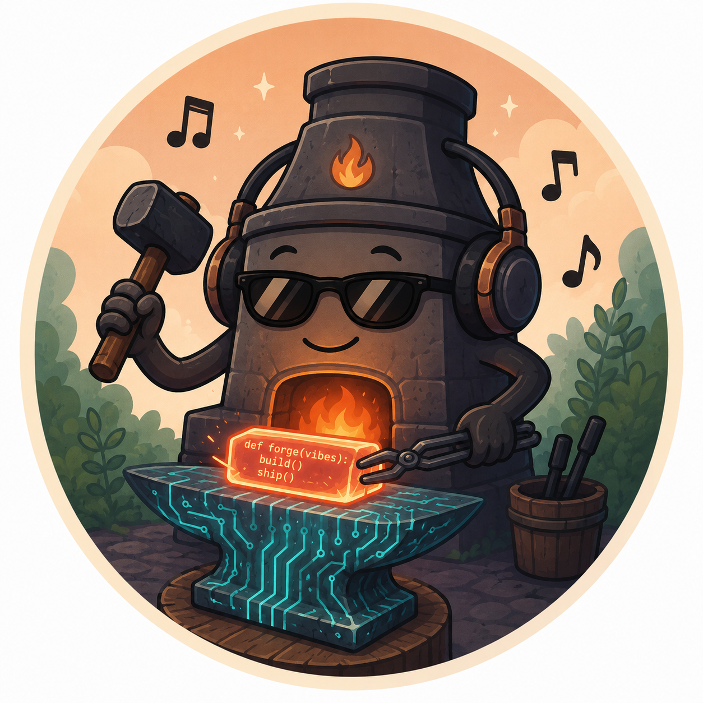

# Forge



Forge is a discipline for software development with AI coding agents (Claude Code,
Codex and OpenCode). It helps single developers in particular build complex software
with an agent: you start from an idea as in vibe coding, and the result gets the
quality that specs, tests and review give.

It is a set of skills, roles and workflows built around one design, in two areas:

- **Craft:** the engineering practices themselves: specifications, test design,
  implementation briefs, code review with verified findings, root-cause fixing,
  architecture, security, UX and documentation.
- **Workflow control:** the steering around the craft: sizing a change, scoping,
  briefs that carry the approved acceptance criteria word for word, delegation to a
  coding agent and to separate reviewers, evidence before "done", and continuing a
  change across sessions.

It is written for developers who use Claude Code, Codex or OpenCode for real software
work. Forge is plain instruction text that the agent reads, plus small helper scripts
that check specific things (task and plan files, workflow state). The instructions
carry the method; the scripts do not enforce it.

## How you work with it

You talk to **Buddy**, the one role Forge puts in front of its skills, roles and
workflows. Tell Buddy what you want to accomplish. It picks up the relevant context
from earlier sessions, works within your project's rules and records what you need to
continue later. Three things stand behind it:

- **Knowledge and continuity** carry goals, decisions and open work across sessions
  through a fact store, a session handoff and a `save` command. Your data stays in
  files you own.
- **Reasoning methods** such as Council, Bedrock and Frame help with decisions and
  can be called directly for a single question.
- **Software development** brings the engineering skills, workflows and roles
  together for specification, implementation, testing and review.

The first two do not need a software project: they work the same way in any folder
you give Buddy.

## Knowledge and continuity

When you pick up a project in a fresh session, Buddy reads its goal in `intent.md`,
retrieves relevant knowledge from `context/` and checks the session handoff. This
works for everyday projects as well as software work.

Say `save` to checkpoint or finish a session. Buddy updates the **handoff** with open
work, blockers and next steps. It saves useful facts and decisions, including their
reasons, in the relevant topic files so you can use them again after the work is
finished. Local continuity works without Git. In a project with a tracked upstream,
`save` also requests a commit and push, subject to the project's rules.
[Daily use and saving](architecture-documentation/13-operational-handbook.md#save-and-finish)

### Keep your own data

The **fact store** is a set of Markdown files in workspaces you control. Buddy can
update them as you work. Project knowledge lives with the project. An optional
personal repository carries your preferences and ongoing topics across projects.
You can also point Buddy to relevant knowledge in another repository it can access.

You can read, edit, back up and move these files yourself. You can reuse them in a
different supported agent host by giving that host access to the files.
[Where project and personal information live](architecture-documentation/13-operational-handbook.md#keep-personal-and-project-information-in-scope)

## Reasoning methods

Ask Buddy for any of these skills directly. Give it the question, goal and constraints.
Each can return its result in the conversation and can also be used within a larger workflow.

- **Council** compares viable choices from different perspectives and summarizes
  their trade-offs and points of disagreement.
- **Bedrock** traces assumptions back to the constraints and values behind them,
  then works forward from those foundations to see what follows.
- **Frame** clarifies what problem you're trying to solve and opens up possible
  approaches.

[When to use each method](architecture-documentation/06-usage-workflows.md#general-reasoning)

## Software development

This is the main part of Forge: the craft and the workflow control from the top of
this page, run as one process. Describe the change, or start from an idea whose
solution is still open.

Buddy sizes the change, carries the approved acceptance criteria into the implementation
brief, delegates coding and review to separate agents, and reports the evidence for the
result. When the work spans sessions, Buddy checks the recorded workflow state before
resuming at the relevant step.

- **Workflows:** `build` (intent → spec → plan → implementation → review → fix →
  close), `fix` (root cause first), `review`, `research`, `solve` (for a problem whose
  solution is still open) and `docs-rewrite`. [Runbooks](workflows/runbooks/navigation.md)
- **Skills**, among them spec authoring and the spec board, test design, adversarial
  test plans, the code review board, root-cause fixing, architecture review, API
  design, security hardening, UX authoring, frontend engineering, migration,
  shipping, and documentation with decision records. [Skill map](framework/skill-map.md)
- **Roles** for the agents a workflow dispatches: the coding agent, the tester, spec
  and code reviewers (adversary, security, data, API contract, reliability and others),
  and a chief that consolidates a board's findings. [Roles](agents/README.md)

You can also ask for a single step, such as a spec board on your spec or a code review
of your branch.

**Discipline in proportion.** The full workflow is for complex changes. A small change
gets a short path: Buddy picks it from what a mistake would cost, how
easily it is undone and how sure it is, and the reply says who built the change and
who checked it. Changes that touch authorization, secrets, data migrations, public
contracts or live systems never take the short path.
[Choosing the path](framework/direct-eligibility.md#choosing-the-path)

## Where it comes from

The idea, the concept and how the parts work together are Forge's own: Buddy as the
one role you talk to, the workflow control around the craft, the project goal every
step works from, and the hand-over between skills, roles and workflows under one set
of rules (the approved goal, your go-ahead for consequential steps, evidence before
"done", effort matched to the stakes).

Where another project had already solved a practice well, Forge adopted it into this
design instead of reinventing it: adapted to Forge's rules and hand-overs, in places
word for word, under their licenses and with credit. These projects inspired it:

- [Superpowers](https://github.com/obra/superpowers) (Jesse Vincent): subagent-driven
  development, systematic debugging, verification before completion.
- [agent-skills](https://github.com/addyosmani/agent-skills) (Addy Osmani): engineering
  skills from security to shipping.
- [BMAD-METHOD](https://github.com/bmad-code-org/BMAD-METHOD): right-sized planning,
  approved acceptance carried verbatim, review triage.
- [spec-kit](https://github.com/github/spec-kit) (GitHub): the specification as the
  source of the code.
- [skills](https://github.com/mattpocock/skills) (Matt Pocock): small engineering
  skills for architecture, diagnosis and design interviews.

[What came from where](framework/adopted-methods.md) · [NOTICE](NOTICE)

## Install and remove

Ask your agent (Claude Code, Codex or OpenCode):

```text
Install Forge from github.com/NashEQify/forge
```

Your agent follows the installation instructions, asks where Buddy should run and
checks that a fresh session starts him. Claude Code and Codex use the Forge plugin.
On OpenCode, setup writes a `forge:boot` skill that points to a Forge checkout or
an existing plugin folder. [Installation instructions](INSTALL.md) ·
[OpenCode setup and verification](architecture-documentation/05-installation.md#opencode)

You need one of those hosts, Git, Bash (Linux, macOS, or WSL on Windows) and Python
3.10 or newer with PyYAML (`python3 -m pip install pyyaml`). Forge calls plain
`python3`, so PyYAML must be available to that interpreter, not only inside a virtual
environment.

**By hand (reference).** Add the plugin from the Forge repository:

```bash
claude plugin marketplace add NashEQify/forge
claude plugin install forge@forge --scope user
```

On Codex the commands are `codex plugin marketplace add NashEQify/forge` and `codex
plugin add forge@forge`.

**Buddy in one project.** Commit this line in the project's `AGENTS.md`:

```text
Forge: start Buddy. Before the first answer, run the forge:boot skill and follow the boot entry it returns.
```

Start your assistant in that folder. Look for a line naming the machine, time and
folder at the start of Buddy's first reply. On the first start, Buddy helps you write
the project's goal into `intent.md` so later sessions can work from it. A teammate who
clones the project can use the same activation line once they set up Forge for their host.

**Buddy in every session (optional).** On Claude Code, set `buddy: every-session` in
`~/.config/forge/user.yaml`, which also names a folder of personal context (who you are,
how you work, open topics) that carries across projects. On Codex, add the same
activation line as above to `~/.codex/AGENTS.md`; the personal-context folder is still
named in `user.yaml`. On OpenCode, setup adds the line to OpenCode's global `AGENTS.md`.

**Change scope or remove.** Ask your agent to switch Buddy's scope or remove Forge.
On Claude Code and Codex, the `forge:setup` skill handles this. [Removal steps](INSTALL.md#remove)

## Limits

- Forge gives the model methods and checks. It cannot guarantee that a model follows
  every instruction or judges correctly, and reviewers can share a wrong assumption.
- It costs time. Buddy reads the project's goal and context at the start of every
  session, so even a quick question takes longer than a bare prompt. Independent review
  adds more; it is worth it where a mistake would be hard to catch or undo.
- Hosts differ in what they load and allow. The setup checks what it can; whether a
  fresh session actually loaded Forge is something to verify, not to assume.
- One `intent.md` per repository.

## Read more

| You want to… | Read |
|---|---|
| See how the parts fit | [Overview](architecture-documentation/01-overview.md) |
| Build or fix software with Forge | [Software development](architecture-documentation/06-usage-workflows.md#software-development) |
| Use the reasoning methods | [Reasoning methods](architecture-documentation/06-usage-workflows.md#general-reasoning) |
| Pick up work in a new session | [Knowledge and continuity](architecture-documentation/06-usage-workflows.md#knowledge-and-continuity) |
| Work with Forge day to day | [Daily use](architecture-documentation/13-operational-handbook.md) |
| Check host support | [Host integrations](architecture-documentation/07-tool-integrations.md) |
| Change Forge itself | [Architecture](architecture-documentation/02-architecture.md) · [Maintainer guide](architecture-documentation/08-development-and-maintenance.md) |

All pages: the [documentation hub](architecture-documentation/README.md).
Contributions: [CONTRIBUTING.md](CONTRIBUTING.md). Security: [SECURITY.md](SECURITY.md).
Community: [CODE_OF_CONDUCT.md](CODE_OF_CONDUCT.md). [MIT license](LICENSE).
