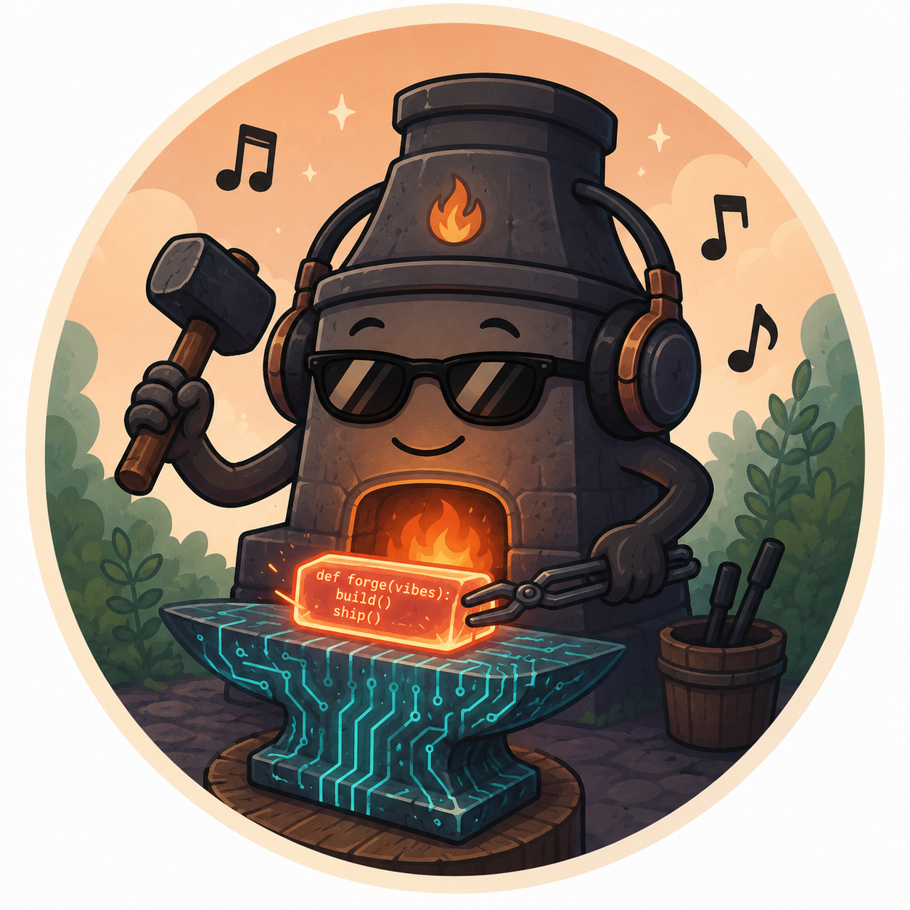

# forge



**Useful context, better reasoning, coherent delivery — across AI sessions.**

Forge is a shared set of skills, instructions and supporting tools for working
with AI agents. It helps an agent remember what matters, examine difficult questions,
and carry software work through to a verified result. You keep your existing agent
application and working folders.

Three capabilities ship together. Use the parts your work needs.

| Capability | What it helps you do | Example |
|---|---|---|
| **Knowledge and continuity** | Keep useful knowledge in the right place, retrieve relevant context and resume open work | Continue an application, plan a trip, or maintain infrastructure knowledge without reconstructing every earlier conversation |
| **General reasoning** | Examine assumptions, compare alternatives and test a decision from independent perspectives | Decide between approaches with a Council, clarify a problem with Frame, or work back to first principles with Bedrock |
| **Software development** | Turn an intent into specifications, implementation, tests and reviews, with tracked progress | Build a feature across sessions or investigate and repair a defect |

Knowledge work needs no software task system. A reasoning method can use the
context you provide without a repository. Software workflows compose these
capabilities when development is selected. Installing more capabilities does not
turn every conversation into a build.

## What changes in everyday use

You describe the work in ordinary language. **Buddy**, Forge's conversational
entry, uses the active project's intent and rules to choose the appropriate depth.
A small question can stay a small question; a consequential decision can receive
more scrutiny.

- **“Use what we already know for this application.”** Relevant topic records and
  current drafts are read before answering. Personal details stay in your configured
  user repository; project knowledge stays with its project.
- **“Compare these options with a Council.”** The method considers distinct
  perspectives and surfaces assumptions, disagreement and uncertainty. Its output
  is a proposal or analysis; it does not silently become your decision.
- **“Implement this feature.”** In a software project, Forge can organize the
  specification, coding, testing and independent review needed for the change.
- **“Save.”** Reconcile useful knowledge and the session handoff. An explicit save
  also requests commit and push to the active project's tracked upstream unless
  local rules restrict it. Selected development work contributes its tracked state.

Useful facts are maintained during the conversation, not only at `save`. A small
profile and topic navigation help the agent find relevant detail without loading
your entire history. Dates, qualifications and source evidence stay where needed;
the system does not need a transcript of every interaction.

Continuity is stored in files in your workspaces. It is not automatic access to
past chats or a background memory service. The agent still needs access to the
right files and must actually read them.

## Choose your starting point

| You want to… | Read |
|---|---|
| Use Forge for everyday work and recurring context | [Daily use](architecture-documentation/13-operational-handbook.md) |
| Understand the three capabilities and their boundaries | [Overview](architecture-documentation/01-overview.md) |
| Install Forge or update an existing installation | [Installation](architecture-documentation/05-installation.md) |
| Use Frame, Bedrock or Council | [Usage and methods](architecture-documentation/06-usage-workflows.md) |
| Build or maintain software | [Development workflows](architecture-documentation/06-usage-workflows.md#software-development) |
| Understand or extend the implementation | [Architecture](architecture-documentation/02-architecture.md) · [Maintainer guide](architecture-documentation/08-development-and-maintenance.md) |

## Installation

Forge runs inside an existing agent host. The coordinated installer supports
Codex, Claude Code and OpenCode integrations; their available features differ.
Cursor rules are provided separately. See [host support](architecture-documentation/07-tool-integrations.md)
for the distinction between shipped instructions and verified host behavior.

Clone Forge and choose an installation preset:

```bash
git clone https://github.com/NashEQify/forge ~/forge
```

- **`daily`** provides knowledge and continuity, save/housekeeping, and Bedrock,
  without the software tooling. Council and Frame can be added explicitly.
- **`full`** makes the development tooling and general methods available as well.

For example, preview a daily installation using an **existing** personal workspace:

```bash
python3 ~/forge/scripts/forge_install.py \
  --profile daily --user-repo ~/projects/personal --check
```

Python with PyYAML is required. `--check` reports planned changes or conflicts;
it does not install anything. Follow the [installation guide](architecture-documentation/05-installation.md)
for application, activation verification and prerequisites. Existing installations
must use the coordinated update procedure: preserve the old state, update during
a maintenance window, install and verify before resuming.

A personal workspace is optional for project-only knowledge and supplied-context
reasoning. There is one shared implementation, not a separate Forge fork per person
or kind of project. Profile selection controls what is installed; project intent
controls how it is used.

## How the parts work together

**Knowledge and continuity** provide the common capture, retrieval and save rules.
The Knowledge Processor decides what belongs where and what has changed. Protected
file operations compare the read baseline before publishing changes and retain
recovery information for interrupted multi-file updates.

**General reasoning** provides reusable methods. Frame clarifies the problem;
Bedrock examines its underlying assumptions; Council brings independent perspectives
to a choice. Methods can return an answer directly. Saving their results is a
separate, authorized action.

**Software development** adds specifications, tasks, implementation, tests, review
and release processes. Its workflow engine tracks explicitly selected work; it is
not a prerequisite for the other capabilities.

All three share authorization, evidence standards and host integration. Concrete
storage choices, domain rules and operational approvals remain with the workspace.
A separate infrastructure repository can keep its own technical knowledge while
using the same common methods.

[Architecture and ownership](architecture-documentation/02-architecture.md) ·
[Canonical capability contract](framework/capabilities.md)

## Scope and limits

Forge is opinionated and pre-1.0. It supplies methods and supporting mechanisms,
not a guarantee that a model will follow every instruction or make correct judgments.
Independent review can catch mistakes; it can also share mistaken assumptions.
Host permissions, tool availability and actual instruction loading matter.

Everyday continuity and a multi-agent review have very different costs. A Council
or review board requires additional model calls, time and tokens. Use that depth
when the uncertainty and consequences justify it; no measured universal cost or
quality improvement is claimed.

Forge does not replace your model or agent application, run a hosted knowledge
service, or make background automations happen from notes alone. Files and imports
remain subject to your storage and privacy rules. File locks coordinate cooperating
Forge writers; they cannot protect against every external editor.

## Explore and contribute

The [documentation hub](architecture-documentation/README.md) offers routes for
users, software builders and maintainers. The [skill map](framework/skill-map.md),
[role index](agents/navigation.md) and [process map](framework/process-map.md) are
reference material when you need the implementation details.

Contributions: [CONTRIBUTING.md](CONTRIBUTING.md). Security reporting:
[SECURITY.md](SECURITY.md). Community guidelines: [CODE_OF_CONDUCT.md](CODE_OF_CONDUCT.md).

[MIT license](LICENSE).
