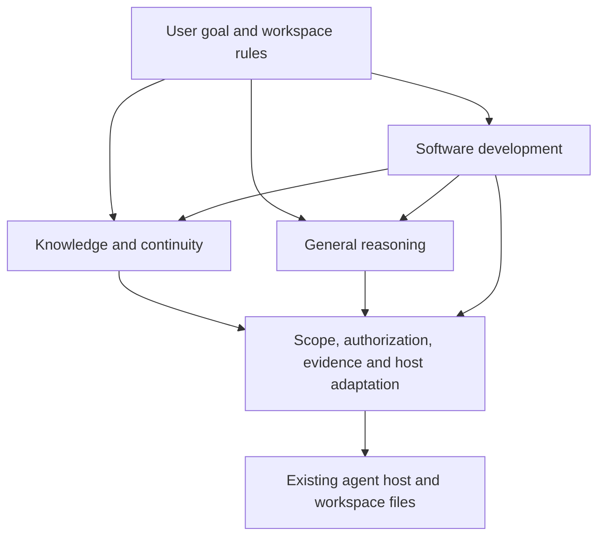

# 02 — Architecture

Forge has three capability owners and a small shared foundation. The boundaries
follow responsibilities, not directories. A skill, helper and host adapter can
cooperate without becoming one universal workflow.

## High-Level

| Capability | Owns | Needs |
|---|---|---|
| Knowledge and continuity | Capture, retrieval, validity, navigation, save and resume | Authorized scope and accessible owners |
| General reasoning | Frame, Bedrock and Council | A supplied problem, context and the selected method's host capabilities |
| Software development | Tasks, plans, specs, implementation, tests and release | Continuity and whichever reasoning methods the work selects |

The [capability contract](../framework/capabilities.md) is the complete ownership
inventory. The shared foundation does not decide a consumer's topic taxonomy,
storage policies, operational approvals or domain meaning.

## Buddy as Orchestrator

Buddy is the conversational entry. It reads the active workspace's intent and
rules before choosing how to work. The `daily` installation always uses the
minimal on-demand start. A `full` installation also takes that path when the
project does not select software development.

On-demand work follows local rules and invokes Forge methods when explicitly
requested. Installing a workflow engine, finding a task file or working in a
folder containing scripts does not select a software workflow. Selection belongs
to the [process map](../framework/process-map.md#workflow-selection).

The [minimal boot](../agents/buddy/boot-on-demand.md) loads relevant continuity,
checks pending recovery and resumes the named handoff. The
[development boot](../agents/buddy/boot.md) adds the selected development context.
Neither boot silently updates shared framework sources while sessions use them.

## Knowledge and continuity

The [Knowledge Processor](../skills/knowledge_processor/SKILL.md) owns semantic
judgment: what is useful, where it belongs, what it corrects and what must be read.
It maintains useful knowledge during work and reconciles it at save.

The [continuity helper](../framework/continuity.md) owns protected file operations.
It captures a coherent same-scope snapshot, compares the baseline before publishing
and records recovery information for interrupted multi-file publication. The model
reasons outside the lock. A stale baseline requires fresh reconciliation.

Personal facts live under the configured user repository's `context/user/`;
project knowledge stays with its project. The [user-scope contract](../framework/user-scope.md)
owns that boundary. Same-scope protection is not a global transaction across
repositories, and cooperating locks cannot exclude an external editor.

## General reasoning

Frame clarifies the problem; Bedrock examines its foundations; Council compares
perspectives. Their contracts accept supplied context without a Git repository,
software task or persistent personal profile.

Independent Council modes separate member analysis from consolidation. Complete
reports reach the Chief before consolidation; Buddy retains decision ownership
and checks consequential source claims. Agreement does not prove correctness.
Host permissions determine whether isolation is enforced or protocol-based.

A useful result may remain inline. Persisting it is caller-owned and authorized
separately; saving a proposal does not turn it into an accepted decision.

## Workflow Model

Software development adds explicit runbooks and mechanical state. The build
runbook organizes specification, preparation, execution, verification and closeout;
other runbooks handle defects, research and review. Their gates apply to selected
work, with proportionality defined by the process map.

The plan engine validates project planning data. The workflow engine interprets
selected workflow definitions, progress, routes and evidence. Neither is a scheduler
or a background worker: an agent or user must invoke it.

[Development continuation](../framework/development-continuation.md) binds exact
selected runs and checks to the common handoff. Restore inspects current state
without advancing or unpausing it. Summaries are not authoritative engine state.
Local `.workflow-state/` is gitignored; pushing a handoff does not transport it.

## Tier Model

| Layer | Responsibility |
|---|---|
| Entry instructions | Stable invariants and the correct boot route |
| Operational instructions | Working and delegation rules for the selected capability |
| Skills, references and protocols | Detail loaded when the current action needs it |

This is a loading discipline, not a separate permission system. Platform permissions
and consumer rules still govern tools and data access. More loaded instructions do
not guarantee better adherence.

## Skill Model

Skills share one format. Frontmatter supplies discovery metadata, while the body
and referenced material define execution. [Skill anatomy](../framework/skill-anatomy.md)
is the contract; the [skill map](../framework/skill-map.md) is the inventory.
Generated wrappers forward to canonical files rather than copying policy.

## Hooks (Mechanism)

Shared Git hooks provide commit-time checks when installed in the active repository.
Configured Claude SessionStart scripts support boot; Codex uses managed AGENTS
instructions and OpenCode uses its launcher. Forge has no tool-event hook layer
for `PreToolUse`, `PostToolUse` or `UserPromptSubmit`.

Protocol requirements, mechanically validated structure and observed host behavior
are different evidence classes. See [host integrations](07-tool-integrations.md)
and the [enforcement registry](../framework/enforcement-registry.md).

## Extension Points

Extend the owner of the responsibility: a method in its skill, continuity semantics
in the Knowledge Processor, protected storage in the continuity helper, host loading
in an adapter. Keep consumer domain policy local. Review the selected dependency
closure when adding a method or installation profile dependency.

Next: [Repository map](03-repository-map.md) · [Core concepts](04-core-concepts.md).
