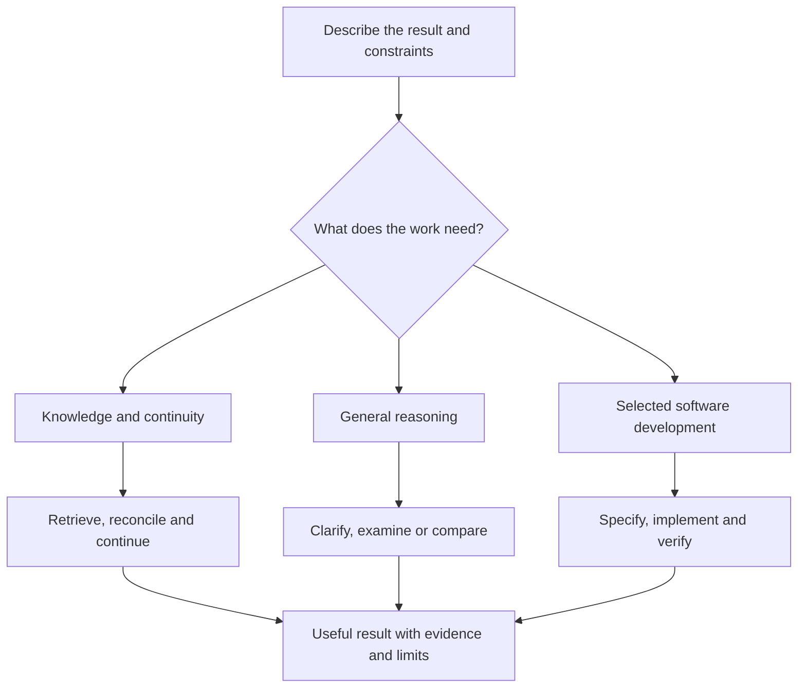
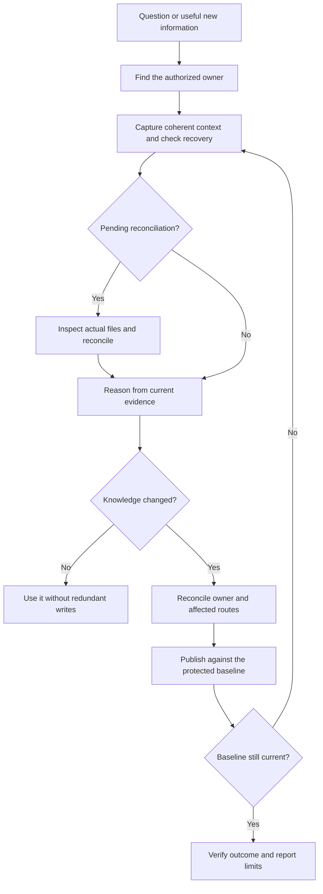
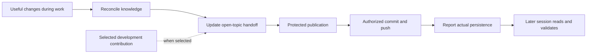
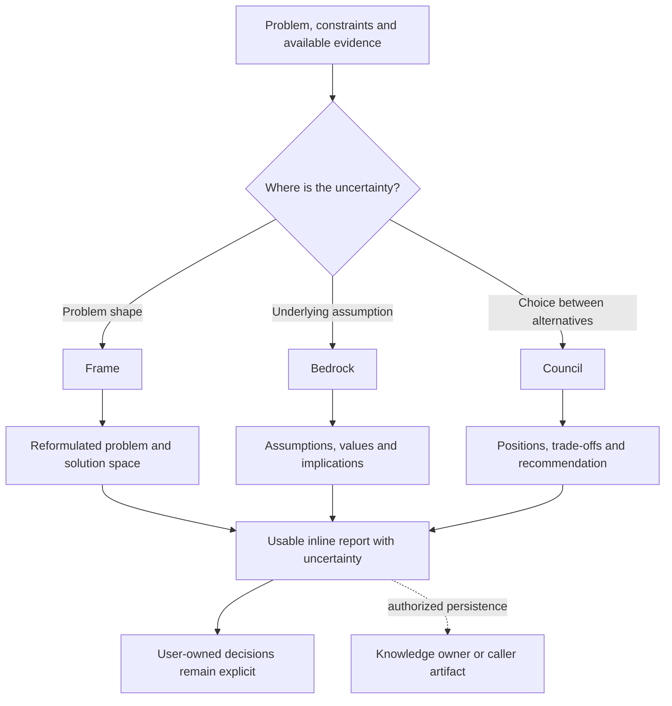
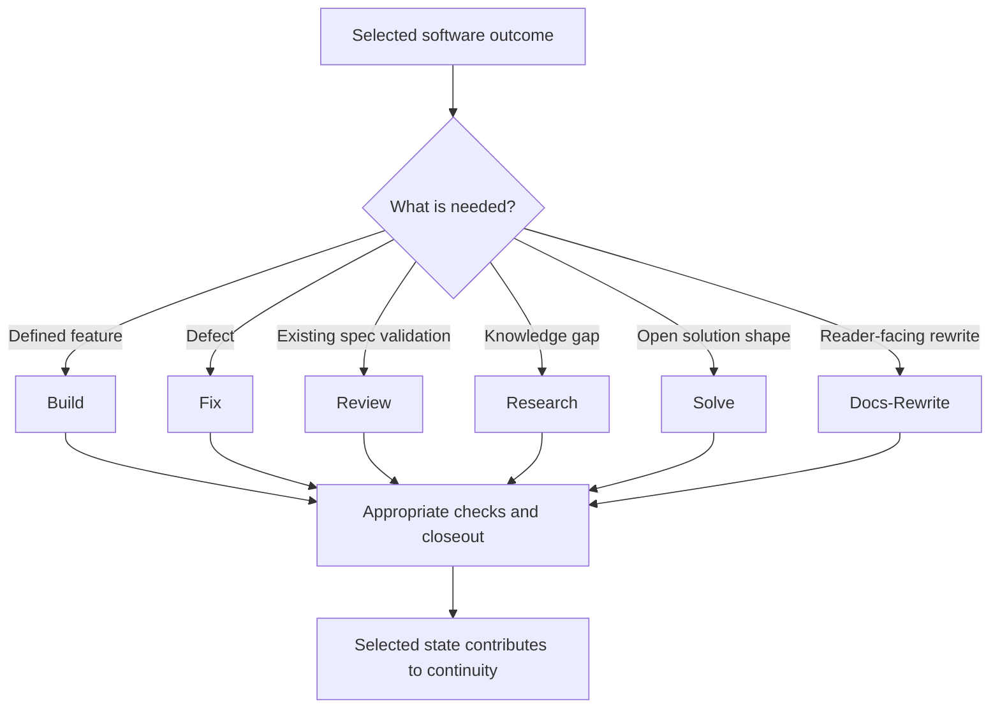
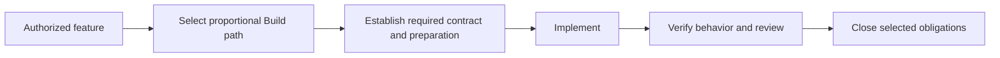
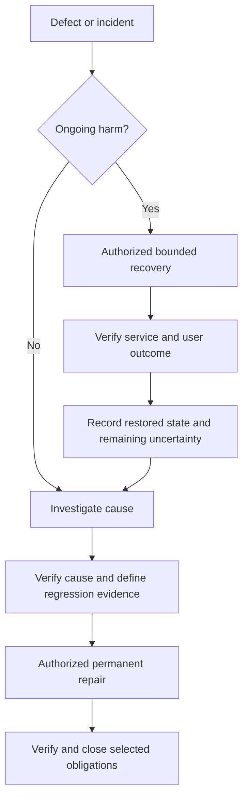

# Visual guide — capabilities and workflows

These diagrams explain the operating shape. Canonical method contracts and runbooks
define the actual steps, gates and completion requirements. Not every request starts
a software workflow.

## Choose the relevant capability

The capabilities compose: a decision can use stored knowledge, and a development
workflow can invoke a reasoning method. The [capability contract](../framework/capabilities.md)
owns the boundaries. Profile selection controls availability, not workflow selection.

## Knowledge and continuity

Personal and project scopes remain separate. Pending recovery must be resolved or
the dependent result qualified. Read the [Knowledge Processor](../skills/knowledge_processor/SKILL.md)
and [protected publication contract](../framework/continuity.md) for exact semantics.

### Save and resume

An explicit `save` requests active-project upstream commit/push unless local rules
restrict it. Ordinary continuous maintenance alone does not. Without Git, save can
still preserve local continuity. A partial publication or missing selected domain
contribution stays visible; the diagram's arrows are not success evidence.
[Save runbook](../workflows/runbooks/save/WORKFLOW.md).

## General reasoning

Supplied context is sufficient. No repository, software task or engine record is
required. Independent Council modes collect member investigations before Chief
consolidation and Buddy's source checks. Interactive Council uses moderated dialogue.
[Frame](../skills/frame/SKILL.md) · [Bedrock](../skills/bedrock_drill/SKILL.md) · [Council](../skills/council/SKILL.md).

## Software development

Development is selected by project intent or explicit invocation. On-demand projects
retain their own working rules; old task files or installed tooling do not select
software automatically. [Process map](../framework/process-map.md#workflow-selection).

### Build and fix

Eligible DIRECT work uses a short complete lifecycle rather than every preparation
gate. Larger or consequential changes retain their selected path's safeguards.
The [Build runbook](../workflows/runbooks/build/WORKFLOW.md) and runtime route definition
own the detailed sequence.

Recovery preserves authorization boundaries and distinguishes restored service from
a resolved cause. [Fix runbook](../workflows/runbooks/fix/WORKFLOW.md).

## State is evidence, not automatic execution

A saved continuation points to exact selected development state. Restore validates
it without advancing or unpausing work. Workflow summaries do not replace the full
state, and gitignored state does not move automatically through Git.

Housekeeping follows the common knowledge lifecycle. An upgrade follows coordinated
installation and fresh verification. Neither needs to invent a software workflow
for ordinary knowledge use.

[Usage and methods](06-usage-workflows.md) · [Daily handbook](13-operational-handbook.md) ·
[Architecture](02-architecture.md) · [Documentation hub](README.md)
